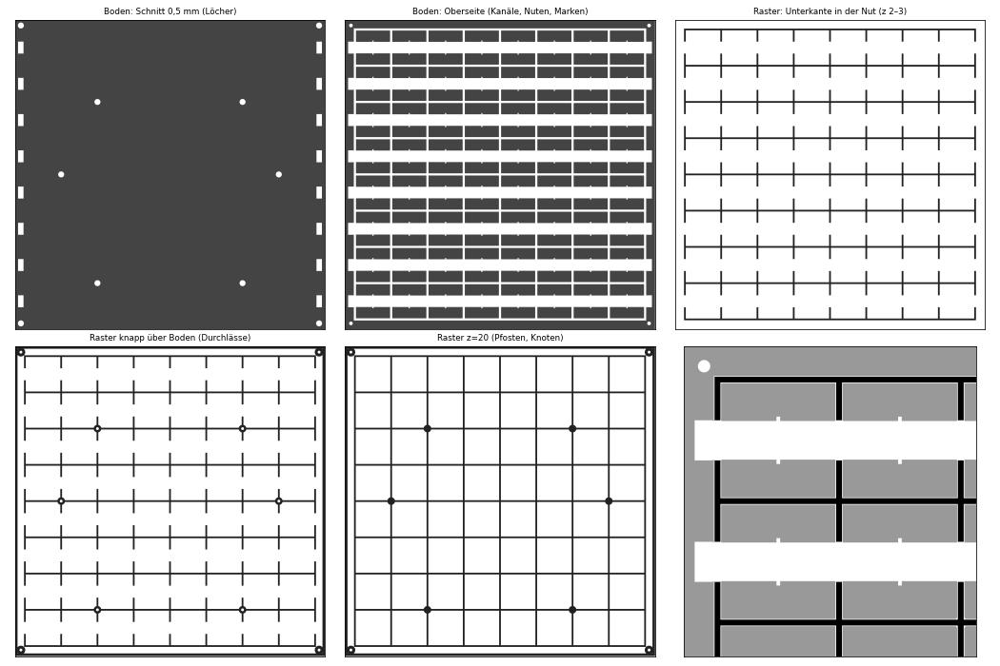

# 3D printing – 今は Wordclock

How the printed parts of the Japanese word clock are made: printer, slicer, settings per part, and what went wrong along the way (and how it was fixed).

## Printer and slicer

| | |
|---|---|
| Printer | **Prusa CORE One L+** (build volume 300 × 300 × 330 mm), enclosed, with Advanced Filtration System |
| Nozzle | standard 0.4 mm brass (Nextruder), not the high-flow nozzle |
| Slicer | **PrusaSlicer 2.9.6** with the Prusa system profiles for the CORE One L, 0.20 mm layers, output as binary G-code (`.bgcode`) |
| Material | **PLA** (black, plus white for the diffuser layer of the front) |
| Print sheet | **satin** sheet – gives the visible face of the front a fine, matte texture |
| Temperatures | 225 °C nozzle, 60 °C bed (Prusa PLA defaults) |

The whole clock (285 × 285 mm) was sized so that each part fits the bed in one piece. With the mouse ears the parts are up to 298 mm wide – there is no room for a skirt or a wide brim.

## Files

All parts are generated by [`cad/wordclock_jp_build.py`](../cad/wordclock_jp_build.py) (front, base, light grid) and the other scripts in [`cad/`](../cad). The 3MF files in [`3d-print-files/3mf/`](../3d-print-files/3mf) are **already oriented for printing** – just load them, do not rotate. [`3d-print-files/stl/`](../3d-print-files/stl) has the same parts as STL (GitHub shows STL files in a 3D viewer – click one to look at it); [`3d-print-files/test/`](../3d-print-files/test) has test strips.

## Parts and settings

| Part | File | Orientation | Material | Notes |
|---|---|---|---|---|
| Front panel (2.8 mm) | `wordclock_jp_front.3mf` | visible face down | black + white | color change at 1.8 mm, see below. About **7 h, 200 g** (0.2 mm layers, 15 % infill). |
| Light grid (23 mm) | `wordclock_jp_raster.3mf` | front side down | black | thin walls (1.6 mm), mouse ears included |
| Base with electronics tray | `wordclock_jp_boden.3mf` | tray facing up | black | largest part, mouse ears included |
| Light-sensor adapter | `wordclock_jp_luxadapter_2mm/_4mm.3mf` | board seat down, pins up | black | only for bases printed before 15.10.2026 |
| Desk stand (optional) | `wordclock_jp_staender_winkel/_gerade.3mf` | on its base | any | no supports needed; rubber feet recommended |

General settings for all parts:

- **Layer height 0.2 mm**, standard PLA profile.
- **Supports: none needed.** All parts are designed to print without supports. The front was sliced with a profile that had supports enabled – check the layer preview: no support material must end up inside the character openings, otherwise it is trapped behind the white diffuser and shows as dark spots. When in doubt, switch supports off.
- **No brim, no skirt** on the large parts – the mouse ears replace the brim. If you prefer a brim instead, at most 6 mm (bed width).
- Clean the sheet with warm water and dish soap before the large parts. Fingerprints are the most common cause of corners lifting.

## The front panel – the tricky part

The front is printed **face down**, so the characters in the model are mirrored. The layers, from the bed upward:

1. **0 – 1.8 mm black**, with the 64 characters cut out
2. **color change (M600)** at 1.8 mm
3. **1.8 – 2.8 mm white** as diffuser; the first white layers bridge over the character openings

The color change is already stored in the 3MF (`Metadata/Prusa_Slicer_custom_gcode_per_print_z.xml`), so PrusaSlicer shows it as a marker on the layer slider. Check it is there before slicing.

**At the M600:**

- The printer stops, unloads black and asks for the new filament.
- Load white and **purge generously until the extrudate is pure white** – any black in the white layer shows as grey streaks when the LEDs are on.
- Remove the purged strand from the nozzle before confirming, so it is not dragged across the part.

**Why 1.0 mm of white:** a diffuser test (`3d-print-files/test/wordclock_jp_test_diffusor.3mf`, three 日 with 0.6 / 1.0 / 1.4 mm white) showed that 0.6 mm is too translucent; 1.0 mm was chosen as the best compromise between even light and brightness.

**Before printing the full front** (7 h), print the test strip `3d-print-files/test/wordclock_jp_test_front.3mf` (日曜日, about 108 × 41 mm). It contains the most complex character 曜 and the color change, so it shows in a short time whether the fine details and bridges come out cleanly.

## What went wrong – and the fixes

### Purge residue in the bridges over the characters

**Symptom:** dark specks or grey streaks in the white of some characters.
**Cause:** after the M600 the first white layer is the bridge over the character openings. Any black residue still in the nozzle ended up exactly there – visible from the front.
**Fix:** the color change was moved **one layer earlier** (since 08.10.2026). The first white layer now goes into the last infill layer of the black part, where residue is invisible, and the bridges are printed with clean white. Additionally: purge longer.

### Bridge lines visible in the white

**Symptom:** fine parallel lines in the lit characters.
**Cause:** the white bridges over the openings are printed as straight lines.
**Fix:** accepted – it looks almost like a paper texture. If it bothers you: 1.0 mm diffuser instead of thinner, slower bridge speed, or a thin sheet of paper/tracing paper behind the front.

### Corners lifting (warping) on base and grid

**Symptom:** corners of the 285 mm parts lift off the bed.
**Fix:** the models have **mouse ears** (0.4 mm discs, Ø 16 mm) at the corners – break them off after printing. Clean the sheet with dish soap. Slight warping of the base is harmless: 10 screws pull it flat against the stiff grid.

### USB-C socket holder too tight

**Symptom:** the socket of the Y-cable did not fit into the holder in the bottom rim.
**Fix:** found with the test print `3d-print-files/test/boden_test.3mf` (a small section of the base with domes, channels and socket holder) before printing the full base. The bed was widened to 14.4 × 8.4 mm and the cable slot to 9 mm. **Lesson:** for the big parts, always print a small test piece of the critical area first.

### Light sensor sticks out over the top rim

**Symptom:** the VEML7700 board protruded about 2 mm beyond the top edge and rested on the edge of the light notch.
**Cause:** the sensor domes were 2 mm too close to the edge for the actual board.
**Fix for already printed bases:** the adapter `wordclock_jp_luxadapter_2mm` (use **M2.5 × 4** screws only) or `_4mm` (M2.5 × 5–8). The first adapter version failed: the screw tip hit the top of the dome and pushed the adapter off – the 2 mm version now has blind holes, the 4 mm version lets the screw pass beside the dome.
**Fix in the model:** since 15.10.2026 the base has the sensor domes 2 mm lower and 6.5 mm high.

## Tips

- **Test strips first.** Every part with a new detail (fine characters, color change, holders, domes) was tested on a small piece before the multi-hour print. That saved several 7-hour prints.
- **Measure your boards.** Hole spacings of the Feather, the USB-C breakout and the sensor are taken from the datasheets; check them with calipers before printing the base – they are parameters in `cad/wordclock_jp_build.py`.
- **Self-tapping screws in PLA:** pilot holes are 2.1 mm for M2.5 and 2.6 mm for M3. Turn gently; PLA cracks easily if a screw is too long and bottoms out.
- **Fit check before assembly:** put the grid onto the base without strips first – the walls must slide into the 1 mm grooves without force.
- **Regenerating parts:** change the parameters at the top of `cad/wordclock_jp_build.py` and run it (needs `fontTools`, `manifold3d`, `trimesh` and the font Noto Sans CJK JP Bold). It writes all 3MF and STL files with the color change already embedded.
