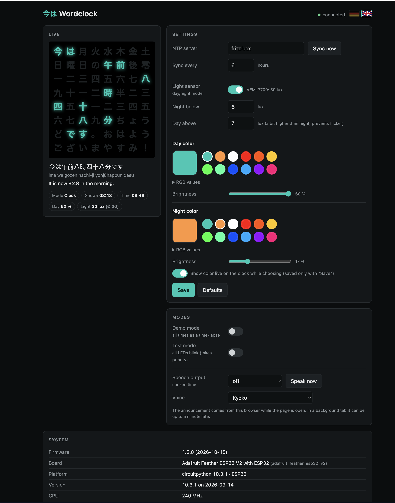
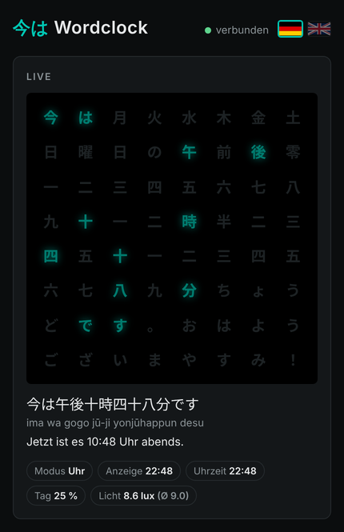
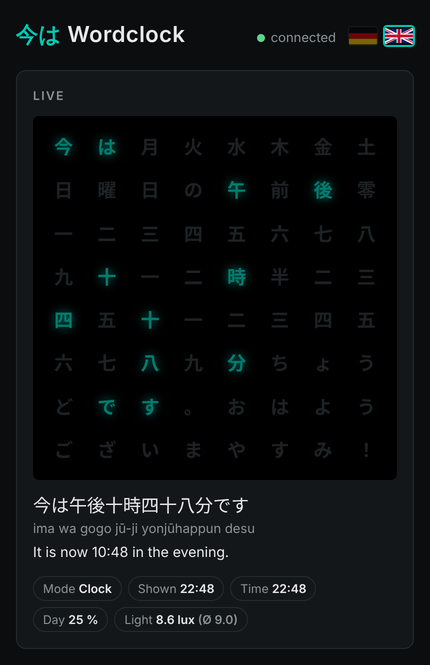

# Web interface – 今は Wordclock

The clock serves a small web interface for live view and settings:

```
http://<board-ip>:8080        e.g. http://192.168.178.103:8080
```

Port 80 is taken by the CircuitPython Web Workflow (file upload), so the clock's own server runs on **8080**. It is served by `webui.py` (based on `ampule`) and polled from the main loop, so it stays reachable in every mode – even without Wi-Fi time sync. The page itself is `index.html` from the board's flash; it works on phone and desktop. The interface is available in **German and English** (see below).



*Desktop layout. Screenshots were rendered with example data; IP, SSID and MAC are placeholders.*

 

*Phone layout (live view), German and English.*

## Header

`今は Wordclock`, a connection indicator (connected / no connection) and two flags for the language. The page refreshes the live state every 2 s.

## Language

Click the 🇩🇪 or 🇬🇧 flag in the header to switch between German and English; the active flag is outlined. The choice is stored in this browser only (`localStorage`, key `wc_lang`) – it is not a setting of the clock, so every browser can use its own language. Without a stored choice the page follows the browser language (German if it starts with `de`, otherwise English).

The language switch translates all labels, messages, the system table and the translation line under the sentence (German from `wordclock_core.german()`, English from `wordclock_core.english()`, both delivered by `/api/state`). The Japanese sentence and the romaji stay as they are. Validation error texts from the clock itself are still in German.

The labels below use the English interface; the German labels are given in brackets.

## Live

- **Grid:** the 8 × 8 characters, lit cells in the current color. The glow follows the current brightness.
- **Sentence** in Japanese, below it the romaji and the translation in the interface language.
- **Chips:**

| Chip | Meaning |
|---|---|
| Mode (Modus) | Clock, Demo or Test |
| Shown (Anzeige) | time currently shown on the grid |
| Time (Uhrzeit) | real time from NTP, or "no NTP" |
| Day / Night / Preview (Tag / Nacht / Vorschau) | active color set and its brightness |
| Announce (Ansage) | announcement interval (only when speech output is on) |
| Light (Licht) | current lux value and moving average (only with a light sensor) |

## Settings (Einstellungen)

Changes in this card take effect with **Save** (Speichern) and are stored permanently in the ESP32's NVM. The flash is only written when a value actually changed. Invalid values are rejected and the field is marked red.

| Field | Key | Default | Range / notes |
|---|---|---|---|
| NTP server (NTP-Server) | `ntp_server` | `fritz.box` | host name or IP. **Sync now** syncs immediately. |
| Sync every (Abgleich alle) | `ntp_interval_h` | 6 | 1–168 hours between syncs |
| Light sensor (Lichtsensor) | `light_sensor` | off | enables day/night switching. Next to it: detected sensor and current lux. |
| Night below (Nacht unter) | `lux_night` | 5 lux | below this value → night |
| Day above (Tag über) | `lux_day` | 15 lux | above this value → day. Keep it higher than the night value (hysteresis), otherwise the clock flickers at dusk. |
| Day color (Farbe Tag) | `day_color` | 0, 200, 180 (turquoise) | color picker, 12 presets, or RGB values (0–255) under **RGB values** |
| Brightness, day (Helligkeit) | `day_brightness` | 25 % | slider up to `MAX_BRIGHTNESS` (60 %) |
| Night color (Farbe Nacht) | `night_color` | 0, 200, 180 | greyed out while the light sensor is off |
| Brightness, night (Helligkeit) | `night_brightness` | 3 % | |

**Live preview:** while you pick a color or move a brightness slider, the clock shows it immediately. This preview is not saved; it ends with **Save** or after 20 s. The switch below the color boxes turns the preview off.

**Defaults** (Standardwerte) resets all settings to the defaults above (after a confirmation).

The day/night switch happens at most every 10 s, and only when the light sensor is enabled. Without a sensor the day settings are always used.

## Modes (Modi)

These switches take effect immediately, no need to save.

| Switch | Key | Effect |
|---|---|---|
| Demo mode (Demo-Modus) | `demo` | runs through all times of day as a time-lapse (one step per second) |
| Test mode (Test-Modus) | `test` | all 64 LEDs on and off alternately every 2 s – for checking wiring and LEDs. Has priority over demo. |
| Speech output (Sprachausgabe) | `voice_interval` | spoken time: off, every minute, every 15 minutes, every hour |
| Voice (Stimme) | – | Japanese voice of this browser (stored only in this browser) |

**Speech output** comes from the browser (Web Speech API), not from the clock, and only while the page is open. Notes:

- Browsers only play sound after a click on the page – press **Speak now** once.
- In a background tab the announcement can be up to a minute late.
- Every open browser speaks.
- Announcements only happen in clock mode, not in demo or test mode.
- If no Japanese voice is listed, install one. On the Mac: System Settings → Accessibility → Spoken Content → System Voice → Manage Voices → Japanese (e.g. Kyoko).

## System

Read-only information from the board:

| Row | Content |
|---|---|
| Firmware | firmware version and date |
| Board / Plattform / Version | board name, CircuitPython version |
| CPU | clock speed (and temperature, if available) |
| RAM / Flash | free and total memory, with a bar |
| Laufzeit | uptime and reset reason |
| WLAN | SSID, signal strength (RSSI), channel |
| IP / Port | address of the web interface, host name |
| MAC | Wi-Fi MAC address |
| NTP | server, last sync, errors, time to next sync |
| LEDs | count, variant, data pin, feed point (`LED_START`), brightness cap |
| Einstellungen | where the settings are stored (NVM or file) |

**Restart** (Neustart) restarts the board (after a confirmation); the page reloads after 15 s.

## Not configurable in the web interface

These are fixed in `code.py` and need a new upload with `deploy.sh`:

- data pin, LED variant and feed point (`LED_PIN`, `LED_VARIANT`, `LED_START`)
- brightness cap (`MAX_BRIGHTNESS`)
- text style (`TEXT_CFG`: 12h/24h, weekday, greetings …)
- analog sensor pin and calibration
- Wi-Fi credentials (`settings.toml` on the board)

## API

The page uses a small JSON API, which can also be called directly, e.g. with curl. Values are passed in the query string, not in the body.

| Method | Path | Description |
|---|---|---|
| GET | `/api/state` | live state (sentence, romaji, German and English translation, speech text, lit cells, color, brightness, day/night, lux) |
| GET | `/api/config` | stored settings |
| POST | `/api/config?key=value&…` | change settings; response contains the new config, the changed keys and errors per field |
| POST | `/api/preview?color=r,g,b&brightness=n` | show a color live without saving |
| POST | `/api/preview?end=1` | end the preview |
| POST | `/api/defaults` | reset to defaults |
| GET | `/api/info` | system information |
| POST | `/api/ntp` | sync time now |
| POST | `/api/reboot` | restart |

Examples:

```bash
# switch on test mode
curl -X POST "http://192.168.178.103:8080/api/config?test=1"

# night brightness 5 %, night color warm white
curl -X POST "http://192.168.178.103:8080/api/config?night_brightness=5&night_color=255,180,100"

# current sentence
curl -s http://192.168.178.103:8080/api/state | python3 -m json.tool
```

There is no authentication – the interface is meant for the home network only.
