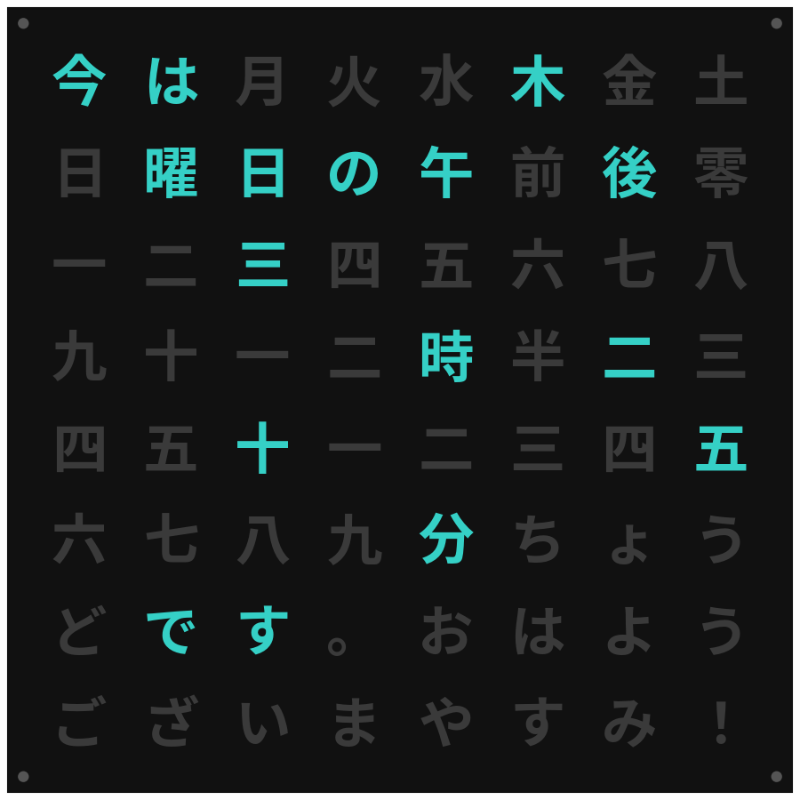
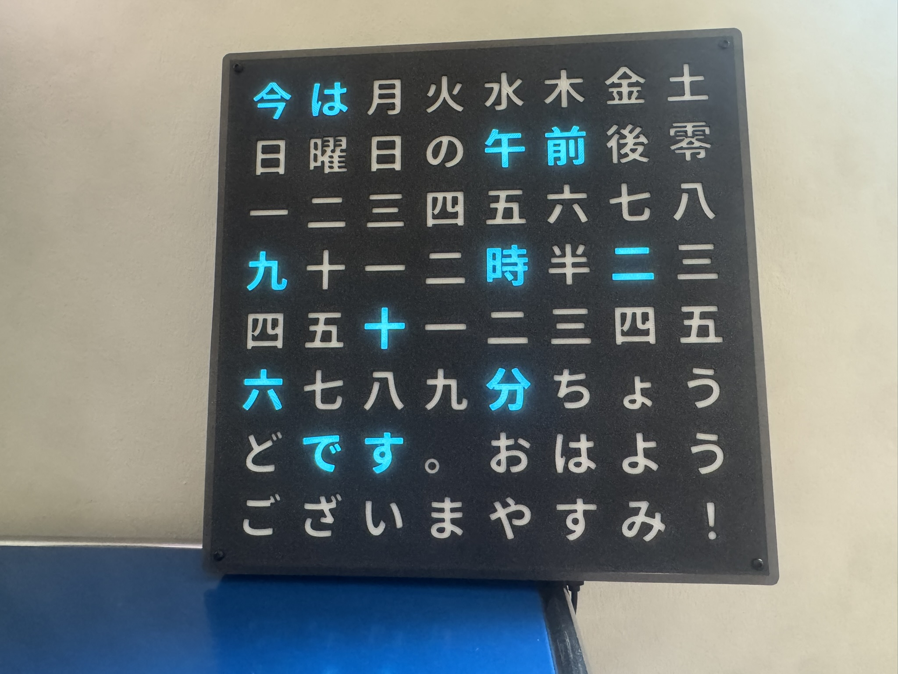
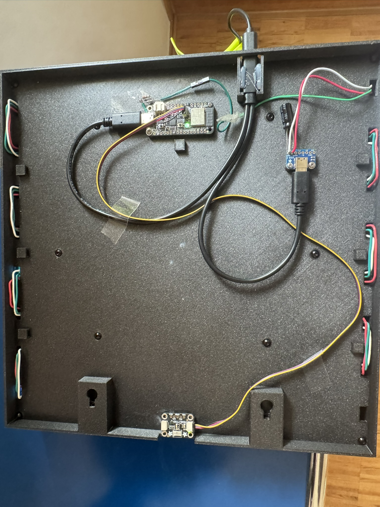
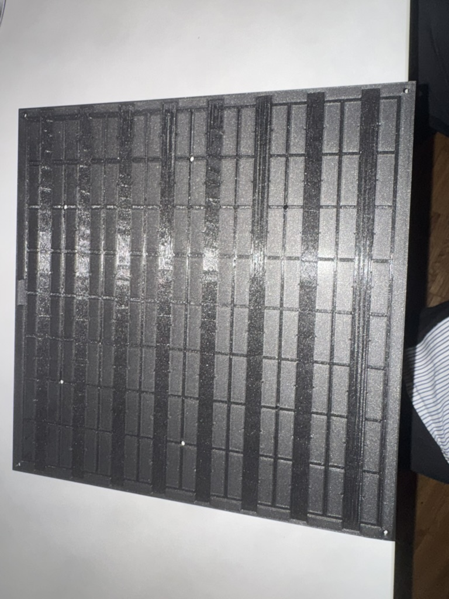
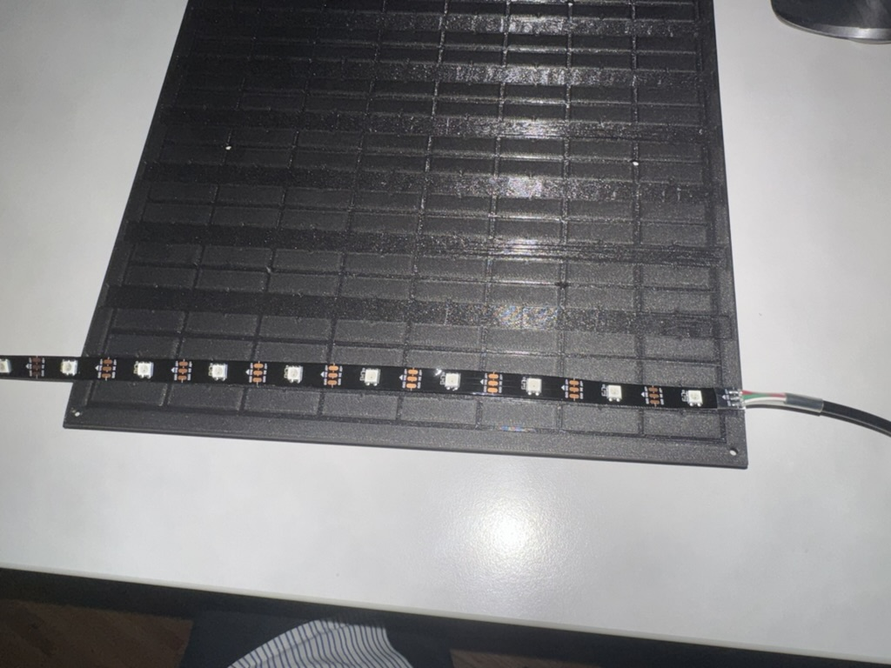
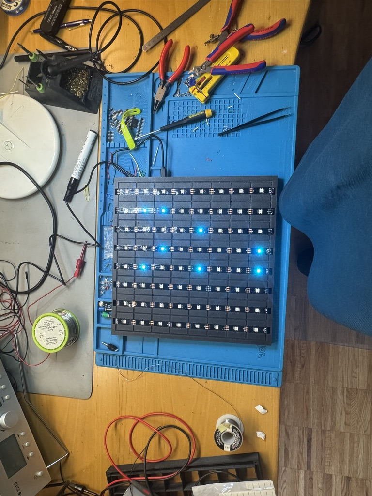
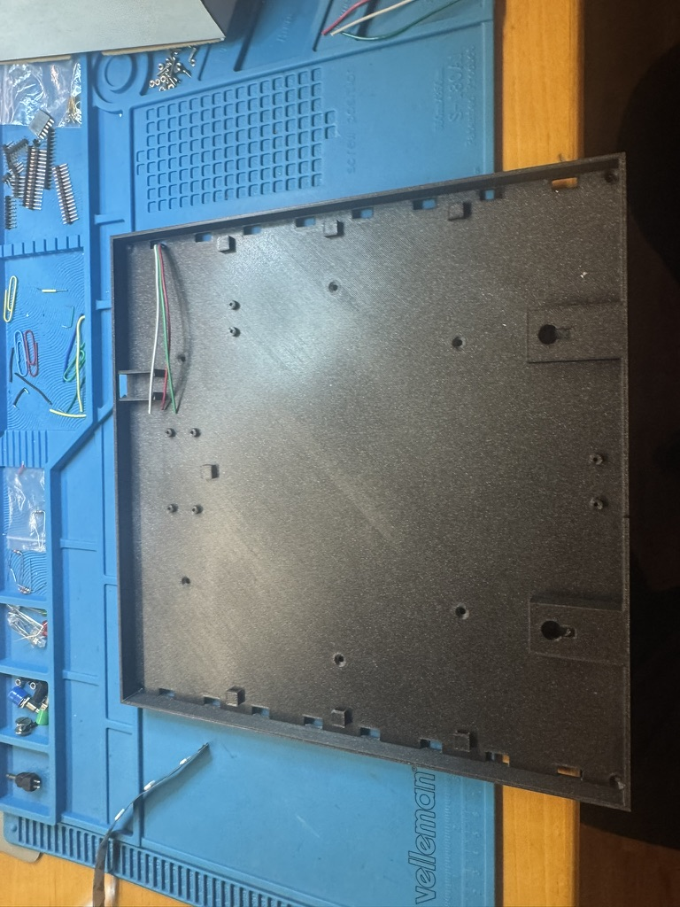
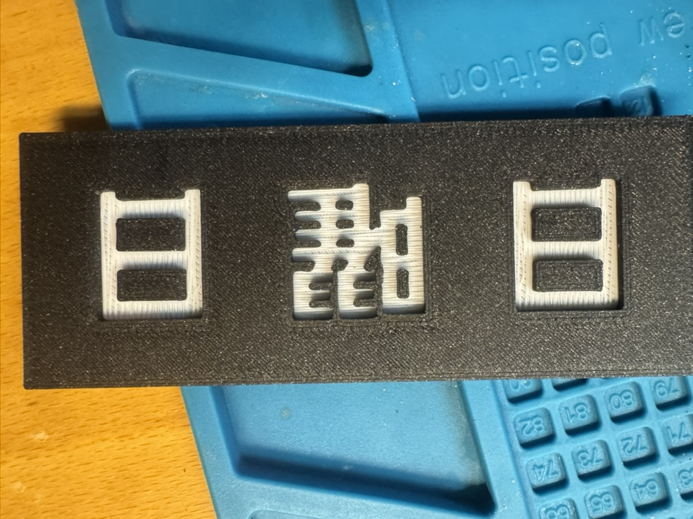
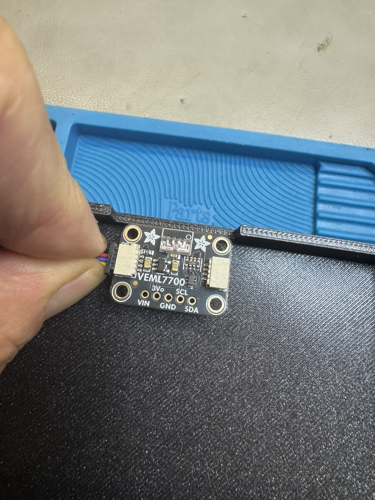

# 今は Wordclock – a Japanese word clock

A Japanese word clock: an 8 × 8 grid of kanji and kana is lit from behind by WS2812B LEDs. Every minute the clock forms a complete Japanese sentence that tells the time, for example

> 今は午後十時四十八分です
> *ima wa gogo jū-ji yonjūhappun desu* – "It is now 10:48 p.m."

The firmware runs on an **Adafruit Feather ESP32 V2** with **CircuitPython 10.x**. It sets the time via NTP, dims the LEDs by day and night using a light sensor, and serves a web interface for live view and settings. The case (285 × 285 × 40 mm) is fully 3D-printed in PLA.



## What's in this repository

| You want to … | Look here |
|---|---|
| see what it looks like | [Photos](#photos) below, [web interface](docs/webui.md) |
| know which parts to buy | [docs/hardware-bom.md](docs/hardware-bom.md) |
| print the case | [3d-print-files/](3d-print-files) (3MF ready to print, STL viewable on GitHub) and [docs/printing.md](docs/printing.md) |
| change the case | [cad/](cad) – parametric Python scripts that generate all print files |
| flash and run the firmware | [Setup](#setup) below |
| fix a problem | [docs/troubleshooting.md](docs/troubleshooting.md) |

## Photos

|                                                                                      |                                                                                             |
|--------------------------------------------------------------------------------------|---------------------------------------------------------------------------------------------|
| <br>Front               | <br>Rear                        |
| <br>Printed base with LED channels | <br>First LED strip in place     |
| <br>All 64 LEDs assembled     | <br>Back side: electronics tray  |
| <br>Test print of the front   | <br>VEML7700 light sensor |

## Letter grid

```
今 は 月 火 水 木 金 土
日 曜 日 の 午 前 後 零
一 二 三 四 五 六 七 八
九 十 一 二 時 半 二 三
四 五 十 一 二 三 四 五
六 七 八 九 分 ち ょ う
ど で す 。 お は よ う
ご ざ い ま や す み ！
```

All 64 cells are used. The grid also supports an optional weekday (今は木曜日の…), "exactly" (ちょうど), midnight as 零時, and greetings at the end (。おはようございます！ / 。おやすみ！).

## Files

| File / folder | Purpose |
|---|---|
| `code.py` | Main program: Wi-Fi, NTP, time zone (Europe/Berlin incl. DST), light sensor, LED output, modes (clock / demo / test), status LED |
| `wordclock_core.py` | Pure logic with no hardware dependencies (also runs under CPython): grid layout, sentence building, romaji, German and English translation, speech text, LED index mapping |
| `config.py` | Persistent settings, stored as JSON in the ESP32's NVM (fallback: `/wordclock_config.json`), with validation |
| `webui.py` | Small HTTP server on port 8080 (based on `ampule`), non-blocking and polled from the main loop |
| `index.html` | Web interface: live grid, sentence with romaji and translation, settings |
| `ampule.py` | Minimal web framework for CircuitPython (vendored, uploaded together with the project) |
| `wordclock_sim.py` | Terminal simulator for the Mac (not uploaded to the board) |
| `deploy.sh` | Uploads changed files to the board over Wi-Fi (CircuitPython Web Workflow) |
| `deploy-manual.sh` | Minimal upload of individual files without comparison |
| `cad/` | Parametric CAD scripts (Python, manifold3d) that generate all print files |
| `3d-print-files/` | Print files: `3mf/` ready to print (oriented, color change embedded), `stl/` same parts as STL, `test/` test strips |
| `docs/` | Documentation: web interface, parts list, 3D printing, troubleshooting |
| `pictures/` | Build photos |

## Hardware

- **Controller:** Adafruit Feather ESP32 V2
- **LEDs:** WS2812B, 30 LEDs/m, 8 strips of 8 LEDs (64 total), data on pin `D33`
  - Variant B (60 LEDs/m, every second LED used, 120 LEDs) is supported via `LED_VARIANT = "B"`
- **Light sensor** (optional, detected automatically):
  - VEML7700 or BH1750 on the STEMMA QT connector (installed: VEML7700)
  - fallback: analog ALS-PT19 on `A2` (use ADC1 pins only – ADC2 does not work while Wi-Fi is active)
- **Power:** 5 V, 3–4 A, split by a Y-cable to the Feather and the LED strips; LED brightness is capped in firmware (`MAX_BRIGHTNESS`)

### LED wiring

The strips are laid out in serpentine order. The feed point is configured in `code.py`:

```python
LED_START = "unten_rechts"   # feed at bottom right (seen from the front)
```

`led_index()` in `wordclock_core.py` accepts `"unten"` (bottom left), `"oben"` (top left) and the same with the suffix `"_rechts"` (right). If every row appears mirrored on the clock, switch between left and right; if the rows are upside down, switch between `unten` and `oben`.

## Setup

1. Flash CircuitPython 10.x onto the Feather ESP32 V2.
2. Create `settings.toml` on the board with Wi-Fi credentials and the Web Workflow password:
   ```toml
   CIRCUITPY_WIFI_SSID = "..."
   CIRCUITPY_WIFI_PASSWORD = "..."
   CIRCUITPY_WEB_API_PASSWORD = "..."
   ```
3. Install the libraries (inside the project's venv, circup ≥ 3):
   ```bash
   ./deploy.sh -l
   # or manually:
   circup --host <board-ip> --password <pw> install neopixel adafruit_ntp adafruit_veml7700 adafruit_bh1750
   ```
4. Upload the project:
   ```bash
   ./deploy.sh
   ```

## Deploying changes

`deploy.sh` downloads each file from the board, compares the content with the local copy and uploads only what has changed. `code.py` always goes last, so the automatic restart already finds all new modules.

```bash
./deploy.sh                 # upload all changed/new files
./deploy.sh -n              # dry run
./deploy.sh -f              # upload everything without comparing
./deploy.sh -l              # also install/update libraries via circup
./deploy.sh code.py         # only the given files
WC_HOST=192.168.x.y WC_PW=... ./deploy.sh   # different board / password
```

The Web Workflow (port 80) is only served on the side while `code.py` is running and can respond slowly. Closing the web interface in the browser helps.

## Web interface

`http://<board-ip>:8080` – full description with screenshots in [`docs/webui.md`](docs/webui.md).

- **Live:** current grid, sentence in Japanese, romaji and German, mode, displayed time, brightness, lux reading
- **Settings:** NTP server and interval, light sensor on/off with lux thresholds for night and day (hysteresis), color and brightness for day and night (with live preview), demo mode, test mode, spoken announcement
- **Speech output:** while the page is open, the browser speaks the time with a Japanese voice (Web Speech API) every 1, 15 or 60 minutes

### API

| Method | Path | Description |
|---|---|---|
| GET | `/api/state` | Live state: sentence, romaji, German, speech text, lit cells, day/night, lux |
| GET | `/api/config` | Stored settings |
| POST | `/api/config?key=value` | Change settings (saved permanently) |
| POST | `/api/preview?color=r,g,b&brightness=n` | Show a color live without saving |
| POST | `/api/preview?end=1` | End the preview |
| POST | `/api/defaults` | Reset to defaults |
| GET | `/api/info` | System information |
| POST | `/api/ntp` | Sync time now |
| POST | `/api/reboot` | Restart |

Values are passed in the query string, not in the body, because `ampule` only reads a body that arrives in the same TCP packet as the headers.

## Modes

- **Clock:** normal operation, updates once per minute
- **Demo:** time-lapse through the day, one step per second
- **Test:** all LEDs on and off alternately (every 2 s) – useful for checking the wiring

The main loop never blocks, so the web interface stays reachable in every mode, even without NTP (for example to correct a wrong NTP server).

## Day/night switching

With the light sensor enabled, the clock reads the brightness once per second and averages it. Below `lux_night` it switches to the night color and brightness, above `lux_day` back to day. Because the two thresholds differ (hysteresis) and there are at least 10 s between switches, the clock does not flicker at dusk.

## Status LED (built-in NeoPixel on the Feather)

| Color | Meaning |
|---|---|
| blue | connecting to Wi-Fi |
| yellow | fetching time |
| green (dim) | running |
| red | error |

## Simulator

The sentence logic can be tested on the Mac without hardware:

```bash
python3 wordclock_sim.py                    # current time
python3 wordclock_sim.py --time 23:55       # fixed time
python3 wordclock_sim.py --live             # runs along, updated every second
python3 wordclock_sim.py --demo 7           # time-lapse, 7 minutes per step
python3 wordclock_sim.py --list             # all 1440 sentences
python3 wordclock_sim.py --check            # does the style fit the grid?
python3 wordclock_sim.py --mode 24h --check
```

## Text style

The sentence style is configured in `TEXT_CFG` in `code.py` (defaults in `wordclock_core.DEFAULTS`):

| Option | Values |
|---|---|
| `hour_mode` | `ampm` (午後十一時), `tageszeit` (夜の十一時), `24h` (二十三時), `plain` (十一時) |
| `zero_hour` | `mixed` (midnight 零時, noon 十二時), `12`, `0` |
| `prefix` | 今は at the start |
| `desu` | です at the end |
| `half` | :30 as 半 instead of 三十分 |
| `exact` | ちょうど on the full hour |
| `weekday` | 今は○曜日の… |
| `greeting` | おはようございます！ (5–9 h) / おやすみ！ (22–1 h) |

## See also

- [`docs/webui.md`](docs/webui.md) – web interface with screenshots
- [`docs/hardware-bom.md`](docs/hardware-bom.md) – parts list
- [`docs/troubleshooting.md`](docs/troubleshooting.md) – known problems and fixes
- [`docs/printing.md`](docs/printing.md) – 3D printing: printer, slicer, settings, lessons learned

## License

- **Code** (firmware, web interface, CAD scripts in `cad/`, deploy scripts): [MIT](LICENSE)
- **3D models, documentation and pictures** (`3d-print-files/`, `docs/`, `pictures/`): [Creative Commons Attribution 4.0 International (CC BY 4.0)](https://creativecommons.org/licenses/by/4.0/) – you may use, change and share them, also commercially, as long as you credit "Thomas Sadowsky – 今は Wordclock" and link to this repository.
- **Third-party components** (`ampule.py`, the Noto Sans CJK character shapes) keep their own licenses – see [THIRD_PARTY_NOTICES.md](THIRD_PARTY_NOTICES.md).

Developed with help from my best developer buddy Claude (Anthropic).
